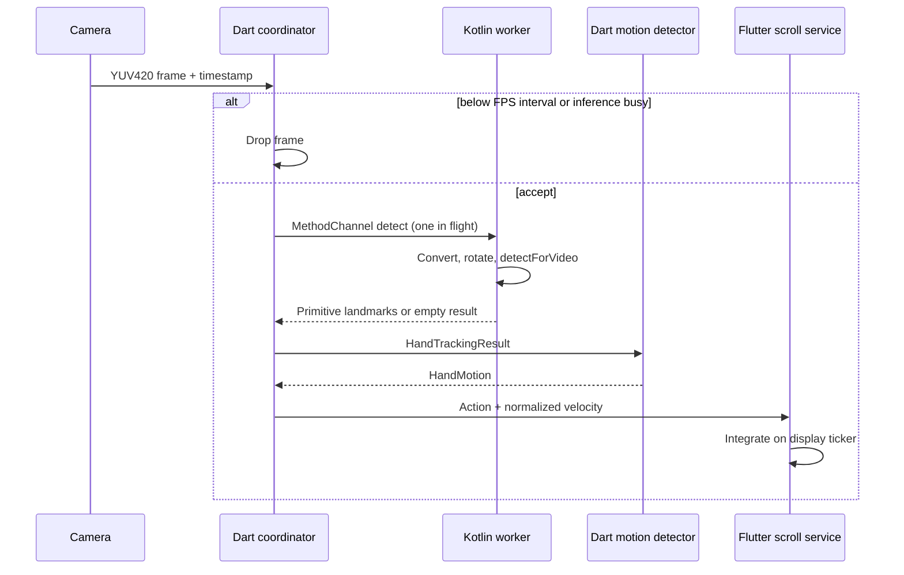

# Architectural decisions

## Scope and layers

The feature folders separate presentation, application coordination, domain contracts/models, and device infrastructure. Pure Dart domain concepts are `HandLandmark`, `HandPose`, `HandTrackingResult`, `HandMotion`, and `HandAction`. The camera frame envelope is also SDK-neutral. `CameraService` exposes the camera package's preview controller as a pragmatic presentation boundary; camera SDK classes do not enter hand/motion models.

The four interfaces correspond to real substitution needs: fake cameras for tests, platform-specific hand tracking, replaceable motion processing, and a future system scrolling adapter. `PositionSmoother` is the one algorithm seam. Everything else is a concrete small implementation; there are no generic repository or use-case layers.

## Dependency injection and ownership

`app/providers.dart` is the composition root. Riverpod's notifier publishes `TrackingState`; a plain `TrackingController` coordinates the services so its lifecycle/backpressure behavior can be tested without Flutter hardware. Dependencies are read when the notifier is built. Configure/override providers before starting the scope; live configuration mutation is not supported yet.

The coordinator owns camera/detector lifecycle. The Flutter scroll provider owns its ticker and `ScrollController`. Leaving the provider scope closes tracking, and native engine cleanup independently closes the channel worker. Camera and tracker disposal are reusable session shutdown operations, allowing a later initialize. Frame timestamps remain monotonic across camera sessions; the native detector resets its timestamp state when reinitialized.

Lifecycle commands are serialized. Stop/background requests invalidate in-flight results immediately and stop scrolling before asynchronous release. The coordinator stops the stream, disposes the camera, awaits the single in-flight inference, closes the detector, and clears motion history. Every resource gets a cleanup attempt even if another fails. A late initialization or inference cannot restart scrolling after stop. Foreground resume honors the previous tracking request; a manual stop or inference failure clears it.

Permission is requested by the camera plugin at initialization. The UI does not ask on launch. Camera-access denial/restriction becomes an actionable error; a retry starts a new session. Inference and cleanup errors are surfaced without accumulating frames or continuing scrolling.

## Threading and backpressure

Default accepted inference rate is capped at 12 FPS. Gating happens before the expensive native bridge. Frames are never queued in Dart. The native boundary independently rejects concurrent detect calls. There is one CPU worker and one retained camera frame. Channel serialization and a small six-sample regression run in Dart; RGB conversion and MediaPipe model creation/inference/destruction run entirely on the Kotlin worker.

VIDEO mode is deliberate: `detectForVideo` on a worker gives one request/one result and preserves MediaPipe's temporal tracking. LIVE_STREAM could be substituted if profiling justifies an event-channel callback contract. GPU delegation and native-only capture are deferred until measurements show a need.

## Channel contract

`autoscroll/hand_tracking` uses StandardMethodCodec:

| Method | Input | Output |
| --- | --- | --- |
| initialize | detectionConfidence, presenceConfidence, trackingConfidence (0..1) | void |
| detect | width/height, rotation (0/90/180/270), monotonic timestampMs, three planes of byte buffers with rowStride/pixelStride | landmarks (0 or 21 xyz triples), optional handedness and handednessConfidence |
| dispose | none | void |

Native validates dimensions, plane count, buffer bounds, strides, rotation, timestamps, and confidence settings. Unsupported frame layouts produce errors rather than interpreting corrupt bytes. Dart validates normalized finite pose values. Only x/y are clamped to [0, 1]; z is relative depth. MediaPipe Java objects stay native. The handedness classification score is retained under its precise name; it is not substituted for absent detection/presence scores.

The CPU detector loads the packaged Flutter asset through FlutterLoader's asset lookup key. The model is in the APK and no application networking code is involved. The release manifest removes INTERNET even if an upstream library adds it; debug/profile retain it for Flutter tooling. Microphone and storage permissions inherited from the camera plugin are removed in all variants. YUV420 plane conversion is stride-aware and happens before portrait sensor rotation. Portrait-up is locked in Flutter, the capture controller, and the Android activity; orientation-aware tablet/foldable support is a later requirement.

The release ProGuard rules preserve fields in protobuf-lite generated messages, retain Flogger's logger classes/factory frames, and keep the MediaPipe framework's JNI data holders/callbacks. MediaPipe reads fields through reflection and JNI and identifies logger callers through the Java stack. Breaking these assumptions can fail initialization or abort the native process only in a shrunk release. Other shrinking remains enabled. Two optional, unused graph-profile/template proto types omitted from the tasks-vision distribution have the specific warning rules generated by R8; the application does not call those APIs. References: the upstream [protobuf-lite rule](https://chromium.googlesource.com/external/github.com/protocolbuffers/protobuf/+/refs/tags/v28.0/java/lite/proguard.pgcfg) and [Flogger factory source](https://github.com/google/flogger/blob/master/api/src/main/java/com/google/common/flogger/FluentLogger.java). Java linkage/initializer errors are logged and returned through the channel as tracking errors; native process aborts cannot be recovered by a Dart or Kotlin exception handler.

## Action semantics and smoothing

| Action | Meaning | Scroll effect |
| --- | --- | --- |
| start | First valid hand after reset, or UI session starts | Hold still during warmup |
| idle | Insufficient samples, dead zone, stale timestamp, or unconfirmed direction | Stop |
| moveUp | Confirmed negative upright-y velocity | Decrease scroll offset |
| moveDown | Confirmed positive upright-y velocity | Increase scroll offset |
| stop | Hand disappears after acquisition, or UI session stops | Stop |

Motion processing averages wrist and finger-base y positions, smooths them, and retains at most six samples. It measures displacement and estimates velocity by least-squares regression with real timestamps. Threshold hysteresis avoids chattering near the movement boundary; confirmation and direction cooldown prevent single-frame reversals. A missing hand clears the smoothing/window immediately. No interpolated or old hand location is used to keep scrolling through occlusion.

`MotionConfig` controls alpha, sample window, minimum valid frames, entry displacement, dead zone, minimum velocity, confirmation count, cooldown, and maximum sample gap. A different `PositionSmoother` can be injected directly into `WindowedMotionDetectionService`. Hand tracking remains completely unaware of these gesture rules.

`ScrollConfig` controls gain, maximum speed, and result freshness. Scrolling uses elapsed display time, not a fixed increment per inference, so list speed does not depend on camera FPS. Bounds and stale-result cancellation are handled by the Flutter adapter. The UI retains normal touch scrolling as well.

## Future Android AccessibilityService

The consumer depends on `ScrollService.handle(HandMotion)`, `stop`, and `dispose`. A future adapter can translate actions into Android accessibility scroll actions or supported gestures without changing camera, hand tracking, or motion detection. The adapter must own system-target discovery, throttling, user-enabled service state and permission flow; normalized velocity is available but Android accessibility actions need not support proportional continuous velocity.

There is no AccessibilityService class, manifest registration, binding permission, accessibility settings prompt, or system gesture dispatch yet. The debug screen deliberately binds its list to the Flutter adapter. A future target selector can replace the injected scroll implementation while keeping the same processing pipeline. Whether camera use must continue when this app loses foreground is a separate Android lifecycle/background-service decision, not solved by swapping the scroll adapter alone.

## Validation boundaries

The Dart tests use synthetic 21-landmark hands with timestamps. They validate motion behavior independently of hardware plus frame gating, lifecycle races, error recovery, initial presentation, and scroll integration. Native JUnit tests validate stride-aware YUV conversion and truncated input rejection. Build/launch verification does not establish hand accuracy, camera alignment on every sensor, battery use, or physical-device FPS. Those remain explicit MVP acceptance tasks in the README.

